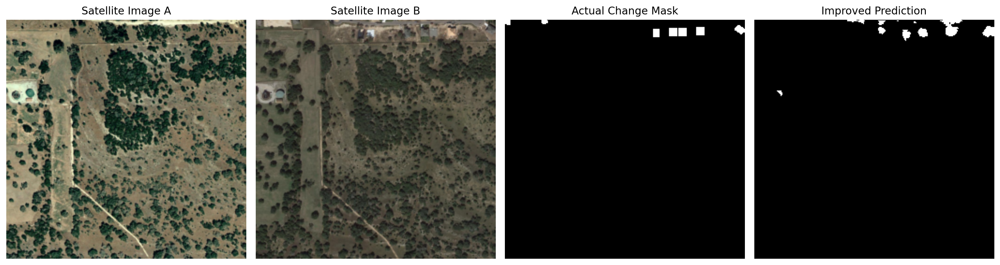

# Satellite Image Change Detection Using Deep Learning

## 1. Project Overview

This project uses deep learning to identify changes between two
satellite images of the same geographical area taken at different times.

A Siamese U-Net architecture is used to generate a binary change mask.

## 2. Dataset

Dataset: LEVIR-CD

Official source:
https://justchenhao.github.io/LEVIR/

The dataset contains:
- Image A: Earlier satellite image
- Image B: Later satellite image
- Label: Ground-truth change mask

The dataset is not included in this repository.

## 3. Model Architecture

Model: Siamese U-Net

- Shared convolutional encoder
- Feature difference using absolute subtraction
- U-Net-style decoder
- Binary change prediction output

## 4. Training Configuration

- Framework: PyTorch
- Input image size: 256 x 256
- Batch size: 4
- Epochs: 10
- Optimizer: Adam
- Learning rate: 0.0001
- Loss function: Weighted Binary Cross Entropy with Logits

## 5. Final Test Results

| Metric | Score |
|---|---:|
| Precision | 0.5360 |
| Recall | 0.8145 |
| F1-score | 0.6465 |

## 6. Technologies Used

- Python
- PyTorch
- Google Colab
- NumPy
- Matplotlib
- Scikit-learn

## 7. Project Structure

satellite-image-change-detection/
├── README.md
├── Satellite_Change_Detection.ipynb
└── siamese_unet_weighted.pth

Note: The trained model file and notebook can be added separately.
The LEVIR-CD dataset should not be uploaded to GitHub.

## 8. Conclusion

The project demonstrates satellite image change detection using
a Siamese U-Net deep learning model.

The weighted loss function helps address class imbalance and
improves the detection of changed pixels.

## 9. Prediction Results

The following image compares the two satellite images,
the actual change mask, and the model's prediction.

## 10. Model Evaluation Results

The trained Siamese U-Net model was evaluated on the LEVIR-CD test dataset.

| Evaluation Metric | Test Score |
|---|---:|
| Precision | 53.60% |
| Recall | 81.45% |
| F1-score | 64.65% |

### Conclusion

The model successfully identifies changed regions between satellite images. The weighted Binary Cross Entropy loss function helps address class imbalance and improves the detection of changed pixels.

The results demonstrate the application of deep learning techniques for satellite image change detection.
